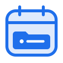
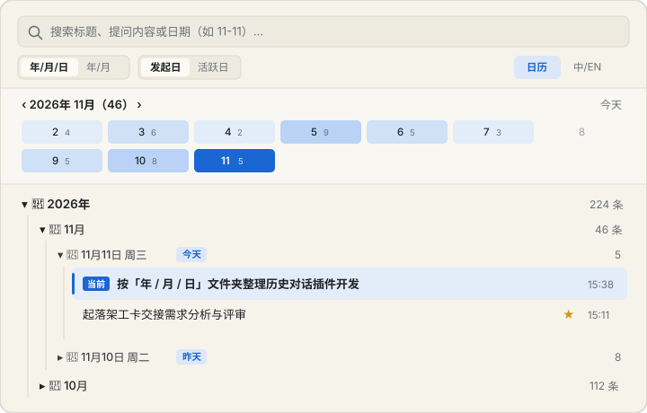

<div align="center">
  
  <h1>Conversation Timeline · 对话时间归档</h1>
  <p>
    Organize Google Antigravity conversations into collapsible <strong>Year / Month / Day</strong> folders with an interactive monthly heat calendar and one-click session switching.<br/>
    将 Antigravity 堆积在一起的历史对话按<strong>「年 / 月 / 日」文件夹</strong>与<strong>月度日历</strong>清晰归档，点击即可一键切换会话。
  </p>
  <p>
    <a href="https://github.com/Wriquet/conversation-timeline/actions"></a>
    <a href="LICENSE"></a>
    
  </p>
</div>

<p align="center">
  
</p>

---

## Why Conversation Timeline? / 为什么做这个插件？

In Antigravity 2.0, hundreds of conversations across weeks and months stack together in a single flat list under each project—making it painful to locate what you discussed on a specific day (and auto-generated English titles often obscure original Chinese prompts).

**Conversation Timeline** uses Antigravity's official **Sidecar Web UI Extension (`SIDECAR_UI_ENTRYPOINT_AUX_PANE`)** API to bring a Finder-style chronological folder tree right into your Side Panel—with **zero host patching** and **100% local read-only indexing**.

Antigravity 2.0 原生左侧栏把所有日期的对话扁平堆叠在一起，时间一长很难按日期翻找，且中文提问常被自动翻译成英文标题。本插件完全基于官方原生 **Side Panel UI 插件接口**构建，不篡改任何宿主文件，开箱即用。

---

## Features / 核心特性

- **Collapsible `Year / Month / Day` Folder Tree（年 / 月 / 日 文件夹树）** — Expand `2026年` → `11月` → `11月11日` like Finder, or toggle to a compact `Year / Month` two-level tree in one click.
- **Interactive Monthly Heat Calendar（月度热力日历）** — See daily conversation counts at a glance; click any date (e.g. `11`) to filter down to that day, and click again to return to the full tree.
- **One-Click Native Switching（一键切换对话）** — Calls `window.sidecar.ui.toggleConversation(id)` to jump straight to any past session, highlighting your active session automatically.
- **Smart Prompt & Artifact Titles + Custom Aliases（智能标题提取 + 自定义重命名 `✎`）** — Extracts readable titles directly from your first prompt (and generated `.md` artifacts), plus lets you rename any session with your own custom note.
- **Starred Folder (`★`), Search & Multi-Project Filter（收藏置顶、全文检索与项目过滤）** — Pin important threads to the top, switch between **Created Date (发起日)** and **Last Updated (活跃日)**, filter by project workspace, and toggle **中文 / English (`中 / EN`)** anytime.
- **Zero Dependencies & Sub-Millisecond Incremental Cache（零第三方依赖、极速增量索引）** — Reads only bounded head/tail chunks of `transcript.jsonl` so hundreds of conversations load instantaneously.

---

## Installation / 安装方法

### Option 1: Antigravity CLI (Recommended / 推荐)

```bash
agy plugin install https://github.com/Wriquet/conversation-timeline
```

### Option 2: Git Clone into Global Plugins Directory

**macOS / Linux:**

```bash
git clone https://github.com/Wriquet/conversation-timeline.git \
  ~/.gemini/config/plugins/conversation-timeline
```

**Windows (PowerShell):**

```powershell
git clone https://github.com/Wriquet/conversation-timeline.git `
  "$HOME\.gemini\config\plugins\conversation-timeline"
```

---

## Usage & Docking Tip / 使用与常驻技巧

1. Open **Customizations → Installed** in Antigravity and make sure **Conversation Timeline** is enabled.
2. Open the panel via any of:
   - Conversation top-right **Overview → Extensions → Conversation Timeline**
   - Side Panel `+` (New Tab)
   - Typing `/conversation-timeline` in chat to get a one-click open pill
3. **Pro Tip — Dock It Permanently（常驻侧边栏技巧）**: Right-click the **Conversation Timeline** tab header in the Side Panel and choose **`Pin Tab`（固定标签页）** so your chronological folder tree stays docked across sessions.

---

## Privacy & Security / 隐私与安全边界

- **100% Local & Offline**: Reads only Antigravity's documented local conversation directory (`~/.gemini/antigravity/brain/<id>/.system_generated/logs/transcript.jsonl`) and `agentapi get-conversation-metadata`. Makes **zero external network requests** (strict CSP `connect-src 'self'`).
- **Strictly Non-Intrusive**: Never modifies conversation transcripts, `config.json`, or Electron application bundles. Stars, custom title aliases, and UI preferences are stored exclusively inside the plugin's own sandboxed `ANTIGRAVITY_EXECUTABLE_DATA_DIR`.

---

## Project Structure / 目录结构

```text
conversation-timeline/
├── plugin.json                              # Official Antigravity plugin manifest
├── assets/
│   ├── logo.svg                             # 1:1 light/dark adaptive plugin icon
│   └── preview.svg                          # UI preview diagram
├── skills/
│   └── conversation-timeline/
│       └── SKILL.md                         # /conversation-timeline skill & pill launcher
└── sidecars/
    └── organizer/
        ├── sidecar.json                     # Aux pane Web UI configuration
        ├── lib.mjs                          # Cross-platform transcript & URI parsers
        ├── main.mjs                         # Sidecar HTTP backend & incremental cache
        ├── index.html                       # Side panel markup (strict CSP)
        ├── styles.css                       # Host theme-token adaptive styles
        ├── app.js                           # Folder tree, mini calendar &zh/en i18n
        └── tests/
            └── organizer.test.mjs           # Node.js built-in test suite
```

## Development / 本地开发与测试

```bash
cd sidecars/organizer
npm test
```

## License

[MIT](LICENSE) © [Wriquet](https://github.com/Wriquet)
